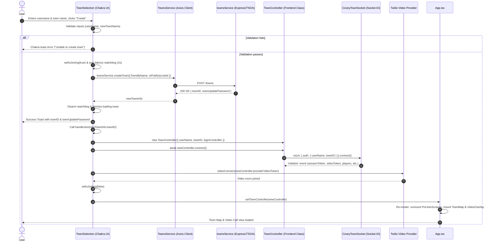

# Frontend Town Creation Form Architecture

This document provides a comprehensive architectural breakdown and execution trace of the **Town Creation Form** in the Covey.Town frontend application. It is designed to help new developers understand how the town creation interface is structured, how Chakra UI components are utilized, how data flows through state and services, and how to safely extend or modify this functionality.

---

## 1. High-Level Architectural Context

Covey.Town is structured around a two-phase connection lifecycle:
1. **Pre-Join / Landing Phase (REST & Device Setup)**: The user configures their media devices and selects or creates a town. All town operations during this stage communicate over HTTP REST with the backend `townService`.
2. **In-Town Phase (WebSocket & Real-Time Sync)**: Once a town is selected or created, the user establishes a persistent Socket.IO connection and a Twilio video session managed by a frontend [`TownController`](../frontend/src/classes/TownController.ts#L127).

The **Town Creation Form** is the entry gateway that transitions a user from the pre-join phase into the active in-town phase by creating a new town instance on the backend and automatically joining it.

### Component Hierarchy

```
[AppStateWrapper] (frontend/src/App.tsx)
  ├── <BrowserRouter>
  ├── <ChakraProvider>               <-- Root Chakra UI styling context
  ├── <MuiThemeProvider>             <-- Material-UI theme provider (legacy video controls)
  └── <AppStateProvider>
        └── [App] (frontend/src/App.tsx)
              └── <LoginControllerContext.Provider value={{ setTownController, townsService }}>
                    └── <UnsupportedBrowserWarning>
                          └── <VideoProvider>
                                ├── <ErrorDialog />
                                └── [PreJoinScreens] (frontend/src/components/VideoCall/...)
                                      └── <IntroContainer>
                                            ├── <MediaErrorSnackbar />
                                            ├── <DeviceSelectionScreen /> (Camera & Mic config)
                                            └── [TownSelection] (frontend/src/components/Login/TownSelection.tsx)
                                                  ├── "Select a username" (<Box>, <FormControl>)
                                                  ├── "Create a New Town" (<Box>, <FormControl>, <Button>)  <-- TOWN CREATION FORM
                                                  └── "Join an Existing Town" (<Box>, <Table>)
```

---

## 2. Chakra UI Component Breakdown

The Town Creation UI is located in [`TownSelection.tsx`](../frontend/src/components/Login/TownSelection.tsx#L28-L363) and built entirely with **Chakra UI** primitives, styled layout blocks, and feedback utilities:

| Component | Role in Town Creation Form | Key Props / Behavioral Details |
| :--- | :--- | :--- |
| `<Stack>` | Vertical stacking container for the entire selection view | Organizes username, create town, and join town sections with uniform vertical spacing. |
| `<Box>` | Semantic card containers (`borderWidth='1px'`, `borderRadius='lg'`, `p='4'`) | Groups related form controls into visual cards with rounded corners and border outlining. |
| `<Flex>` | Flexbox row container (`p='4'`) | Lays out the town name input field, the public checkbox, and the Create button in a horizontal row. |
| `<Heading>` | Section headings (`as='h2'`, `size='lg'`) | Provides accessible headings (`Select a username`, `Create a New Town`, `Join an Existing Town`). |
| `<FormControl>` | Chakra form control context | Encloses inputs and their corresponding labels for accessibility (`htmlFor`) and focus state management. |
| `<FormLabel>` | Accessible input labels | Associates labels with form inputs (e.g., `htmlFor='name'`, `htmlFor='townName'`, `htmlFor='isPublic'`). |
| `<Input>` | Single-line text entry | Used for `userName` (with `autoFocus`) and `newTownName`. Controlled via `value` and `onChange`. |
| `<Checkbox>` | Boolean toggle checkbox | Used for `isPublic` (`isChecked={newTownIsPublic}`). Dictates if the town will appear in public listings. |
| `<Button>` | Primary action trigger | Label `"Create"`, `data-testid='newTownButton'`. Has `onClick={handleCreate}`, `isLoading={isJoining}`, and `disabled={isJoining}` to prevent multi-submissions. |
| `useToast()` | Floating feedback alerts | Dispatches status alerts for validation errors (`status: 'error'`), long cold-start warnings (`status: 'info'`), and creation credentials (`status: 'success'`). |

> [!NOTE]
> The Covey.Town frontend uses **both Chakra UI and Material-UI**. While the video preview components in `DeviceSelectionScreen` still use legacy Material-UI, all newer forms including `TownSelection.tsx` and `TownSettings.tsx` strictly use **Chakra UI**. New extensions to the form should follow this pattern and use Chakra UI components.

---

## 3. State Management & Data Flow

### Local Form State

Inside [`TownSelection`](../frontend/src/components/Login/TownSelection.tsx#L28-L38), the following React state variables govern the creation process:

```typescript
const [userName, setUserName] = useState<string>('');
const [newTownName, setNewTownName] = useState<string>('');
const [newTownIsPublic, setNewTownIsPublic] = useState<boolean>(true);
const [isJoining, setIsJoining] = useState<boolean>(false);
```

- `userName`: Held in the top card of the form. Required by both town creation and town joining.
- `newTownName`: Controlled string representing the friendly display name for the new town.
- `newTownIsPublic`: Controlled boolean defaulting to `true`. Determines if `isPubliclyListed` is set on the backend.
- `isJoining`: Acts as a submission lock. When `true`, it triggers loading spinners (`isLoading`) and disables buttons across the entire form to avoid duplicate API calls or race conditions.

### Contexts & Custom Hooks

1. **[`useLoginController`](../frontend/src/hooks/useLoginController.ts#L8-L14)**:
   - Consumes [`LoginControllerContext`](../frontend/src/contexts/LoginControllerContext.tsx#L6-L11).
   - Provides:
     - `townsService`: An instance of `TownsService` (generated Axios REST client).
     - `setTownController`: The root state setter `(controller: TownController | null) => void` declared in [`App.tsx`](../frontend/src/App.tsx#L24).
2. **`useVideoContext()`**:
   - Provides `connect: videoConnect` from the Twilio video wrapper to initialize video/audio tracks with a video room token.
3. **`useToast()`**:
   - Chakra UI hook that creates dismissible or persistent toasts.

---

## 4. End-to-End Execution Trace (`handleCreate`)

When the user enters a username, a town name, and clicks the **Create** button (`data-testid='newTownButton'`), [`handleCreate`](../frontend/src/components/Login/TownSelection.tsx#L139-L235) is invoked.

### Flow Diagram



### Detailed Trace of Steps

#### Step 1: Client-Side Input Validation
```typescript
if (!userName || userName.length === 0) {
  toast({
    title: 'Unable to create town',
    description: 'Please select a username before creating a town',
    status: 'error',
  });
  return;
}
if (!newTownName || newTownName.length === 0) {
  toast({
    title: 'Unable to create town',
    description: 'Please enter a town name',
    status: 'error',
  });
  return;
}
```
Validation occurs synchronously before touching any network resource. If empty, execution terminates immediately.

#### Step 2: High-Latency Service Watchdog Timer
Render.com free-tier instances sleep when inactive. To keep the user informed during slow cold starts, a watchdog timer is started:
```typescript
const isHighLatencyTownService =
  process.env.NEXT_PUBLIC_TOWNS_SERVICE_URL?.includes('onrender.com');
let loadingToast: ToastId | undefined = undefined;
const connectWatchdog = setTimeout(() => {
  loadingToast = toast({
    title: 'Please be patient...',
    description: isHighLatencyTownService
      ? "The TownService is starting up - this may take 15-30 seconds..."
      : "Connecting to town... This is taking a bit longer than normal...",
    status: 'info',
    isClosable: false,
    duration: null,
  });
}, 2000);
setIsJoining(true);
```
- Sets `isJoining = true`, causing the Chakra `<Button>` to render an animated spinner via `isLoading={isJoining}`.
- If the server responds in < 2 seconds, the timer is cleared and no toast is ever shown.

#### Step 3: REST API Call (`createTown`)
```typescript
const newTownInfo = await townsService.createTown({
  friendlyName: newTownName,
  isPubliclyListed: newTownIsPublic,
});
```
- Calls the generated REST method [`createTown`](../townService/src/town/TownsController.ts#L58-L68) on `TownsService`.
- The backend initializes a new `Town` inside [`TownsStore`](../townService/src/lib/TownsStore.ts#L83-L97).
- Returns a [`TownCreateResponse`](../townService/src/api/Model.ts#L25-L36):
  ```typescript
  {
    townID: string;              // Unique identifier (nanoid)
    townUpdatePassword: string;  // Secret administrative password
  }
  ```

#### Step 4: Success Toast Notification
```typescript
clearTimeout(connectWatchdog);
setIsJoining(false);
if (loadingToast) toast.close(loadingToast);

toast({
  title: `Town ${newTownName} is ready to go!`,
  description: (
    <>
      {!newTownIsPublic && <p>This town will NOT be publicly listed. To re-enter it, you will need to use this ID: {newTownInfo.townID}</p>}
      Please record these values in case you need to change the town:
      <br />Town ID: {newTownInfo.townID}
      <br />Town Editing Password: {newTownInfo.townUpdatePassword}
    </>
  ),
  status: 'success',
  isClosable: true,
  duration: null, // Toast remains until explicitly closed by user
});
```
Because the `townUpdatePassword` is needed to edit or delete the town later, this toast has `duration: null` so the creator has time to copy it.

#### Step 5: Automatic Town Connection (`handleJoin`)
Immediately following creation, `handleCreate` invokes `await handleJoin(newTownInfo.townID)`:
1. Instantiates a new [`TownController`](../frontend/src/classes/TownController.ts#L214-L232):
   ```typescript
   const newController = new TownController({
     userName,
     townID: coveyRoomID,
     loginController,
   });
   ```
2. Connects the socket via [`connect()`](../frontend/src/classes/TownController.ts#L598-L645):
   - Opens Socket.IO connection to `NEXT_PUBLIC_TOWNS_SERVICE_URL` with auth payload `{ userName, townID }`.
   - Backend dispatches an `'initialize'` socket event containing the full town state (`sessionToken`, `providerVideoToken`, players, interactables).
   - Resolves the promise when `'initialize'` arrives.
3. Connects to video provider:
   ```typescript
   const videoToken = newController.providerVideoToken;
   await videoConnect(videoToken);
   ```
4. Updates application state:
   ```typescript
   setTownController(newController);
   ```

#### Step 6: Transition in `App.tsx`
In [`App.tsx`](../frontend/src/App.tsx#L32-L44):
```tsx
let page: JSX.Element;
if (townController) {
  page = (
    <TownControllerContext.Provider value={townController}>
      <ChatProvider>
        <TownMap />
        <VideoOverlay preferredMode='fullwidth' />
      </ChatProvider>
    </TownControllerContext.Provider>
  );
} else {
  page = <PreJoinScreens />;
}
```
Setting `townController` causes `App` to unmount `<PreJoinScreens />` and mount the 2D Phaser game map (`<TownMap />`) and video overlay (`<VideoOverlay />`).

---

## 5. Secondary Town Form: Town Settings & Modification

In addition to `TownSelection.tsx`, the frontend provides an in-game modal form for editing or deleting the town: [`TownSettings.tsx`](../frontend/src/components/Login/TownSettings.tsx#L23-L175).

### Key Architectural Differences

| Feature | Town Creation (`TownSelection.tsx`) | Town Settings (`TownSettings.tsx`) |
| :--- | :--- | :--- |
| **Location** | Pre-join screen (login) | In-game hamburger menu item |
| **Chakra UI Container** | Stack / Box inline form | `<Modal>`, `<ModalOverlay>`, `<ModalContent>` |
| **Game Interaction** | Game is not yet running | Pauses game loop via `coveyTownController.pause()` when open; unpauses via `unPause()` when closed |
| **Authorization** | None required (anyone can create a town) | Requires `roomUpdatePassword` (the `townUpdatePassword` received during creation) |
| **Controller Hook** | `useLoginController()` | `useTownController()` |
| **Actions** | Create town -> automatic join | Update town (`updateTown`) or delete town (`deleteTown`) |

---

## 6. Full-Stack Contract & OpenAPI Code Generation

The frontend does not manually write HTTP `fetch` or `axios` calls to create towns. Instead, it relies on automated code generation:

```
[townService/src/town/TownsController.ts] (TSOA Decorators)
                    │
                    ▼ npm run swagger (townService)
[shared/generated/swagger.json] (OpenAPI Specification)
                    │
                    ▼ npm run client (frontend)
[frontend/src/generated/client] (Axios client: TownsService, TownCreateParams, etc.)
```

### The Request Model: `TownCreateParams`

Defined on the backend in [`Model.ts`](../townService/src/api/Model.ts#L41-L60):

```typescript
export interface TownCreateParams {
  friendlyName: string;
  isPubliclyListed: boolean;
  mapFile?: string; // Optional: controls Tiled map file. Not currently exposed on frontend!
}
```

> [!IMPORTANT]
> Notice that the backend model already supports `mapFile?: string`. If you want to allow users to select custom map files (e.g. standard map vs custom rooms), the backend is already prepared to accept this field. Only the frontend Chakra UI form needs to expose a field for it!

---

## 7. Testing Architecture (`TownSelection.test.tsx`)

The test suite in [`TownSelection.test.tsx`](../frontend/src/components/Login/TownSelection.test.tsx#L511-L661) verifies the town creation form using `@testing-library/react` and `jest-mock-extended`.

### Mocking Strategy

The tests mock the following external dependencies:
1. `mockTownsService`: Mock of `TownsService` to spy on `createTown` and `listTowns`.
2. `mockLoginController`: Provides `{ setTownController, townsService: mockTownsService }`.
3. `mockToast`: Replaces Chakra's `useToast` to assert error and success toast calls.
4. `coveyTownControllerConstructorSpy`: Asserts that `new TownController(...)` is called with the correct parameters upon creation.
5. `mockConnect`: Asserts that the video provider connect method was called.

### Test Helper Example

```typescript
const createTownWithOptions = async (params: {
  townName: string;
  userName: string;
  togglePublicBox?: boolean;
  townID?: string;
  roomPassword?: string;
  errorMessage?: string;
}) => {
  fireEvent.change(userNameField, { target: { value: params.userName } });
  fireEvent.change(newTownNameField, { target: { value: params.townName } });
  if (params.togglePublicBox) {
    fireEvent.click(newTownIsPublicCheckbox);
  }
  // Setup mock return or rejection on mockTownsService.createTown ...
  userEvent.click(newTownButton);
};
```

---

## 8. Developer Extensibility Guide

If you need to modify or add fields to the Town Creation Form (for instance, map selection, town passwords, max occupancy, or room themes), follow this systematic checklist:

### Step 1: Update the Backend Contract
1. Add new properties to [`TownCreateParams`](../townService/src/api/Model.ts#L41-L60).
2. Update the backend [`TownsStore.createTown`](../townService/src/lib/TownsStore.ts#L83-L97) and [`TownsController.createTown`](../townService/src/town/TownsController.ts#L58-L68) to receive and apply the parameters to the `Town` instance.

### Step 2: Regenerate the OpenAPI Client
From the repository root:
```bash
cd townService
npm run swagger
cd ../frontend
npm run client
```
This updates `frontend/src/generated/client` so that `townsService.createTown` accepts the new TypeScript types.

### Step 3: Add Chakra UI Form Components in `TownSelection.tsx`
1. Define state for the new field:
   ```typescript
   const [mapChoice, setMapChoice] = useState<string>('default');
   ```
2. Insert the appropriate Chakra UI component inside the `<Box>` enclosing `"Create a New Town"`:
   ```tsx
   <FormControl>
     <FormLabel htmlFor='mapSelect'>Map Layout</FormLabel>
     <Select
       id='mapSelect'
       value={mapChoice}
       onChange={e => setMapChoice(e.target.value)}>
       <option value='default'>Default Campus</option>
       <option value='arena'>Game Arena</option>
     </Select>
   </FormControl>
   ```
3. Update `handleCreate` to pass the new property into `townsService.createTown`:
   ```typescript
   const newTownInfo = await townsService.createTown({
     friendlyName: newTownName,
     isPubliclyListed: newTownIsPublic,
     mapFile: mapChoice,
   });
   ```

### Step 4: Update Unit Tests in `TownSelection.test.tsx`
1. Find input elements by label or placeholder using `@testing-library/react` queries (`getByLabelText`, `getByPlaceholderText`, or `getByRole`).
2. Add test assertions verifying that `mockTownsService.createTown` is called with the expected values.
3. Test validation edge cases with error toasts if the new field has constraints.

---

## 9. Summary Reference Table

| Aspect | Location / Reference |
| :--- | :--- |
| **Main Form File** | [`TownSelection.tsx`](../frontend/src/components/Login/TownSelection.tsx) |
| **Form Submit Handler** | [`handleCreate` in TownSelection.tsx](../frontend/src/components/Login/TownSelection.tsx#L139-L235) |
| **Join Handler** | [`handleJoin` in TownSelection.tsx](../frontend/src/components/Login/TownSelection.tsx#L54-L137) |
| **Parent Screens Container** | [`PreJoinScreens.tsx`](../frontend/src/components/VideoCall/VideoFrontend/components/PreJoinScreens/PreJoinScreens.tsx) |
| **Application Root** | [`App.tsx`](../frontend/src/App.tsx) |
| **Login Controller Context** | [`LoginControllerContext.tsx`](../frontend/src/contexts/LoginControllerContext.tsx) |
| **Town Controller Class** | [`TownController.ts`](../frontend/src/classes/TownController.ts) |
| **Town Settings Modal** | [`TownSettings.tsx`](../frontend/src/components/Login/TownSettings.tsx) |
| **Backend REST Endpoint** | [`TownsController.createTown` in townsService](../townService/src/town/TownsController.ts#L58-L68) |
| **Backend Params Model** | [`TownCreateParams` in townService/src/api/Model.ts](../townService/src/api/Model.ts#L41-L60) |
| **Form Unit Tests** | [`TownSelection.test.tsx`](../frontend/src/components/Login/TownSelection.test.tsx) |
